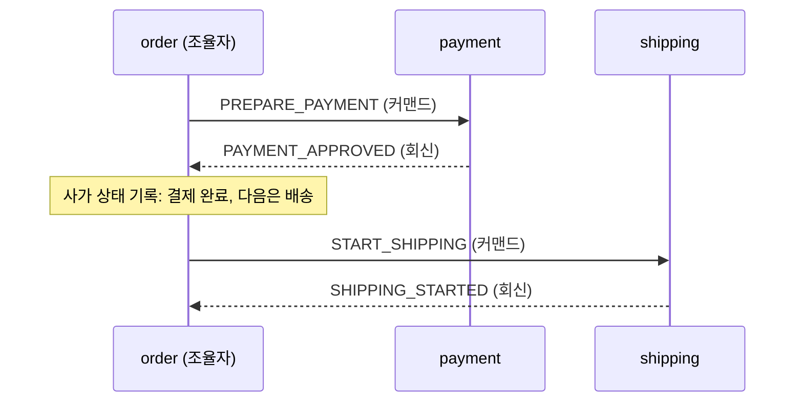
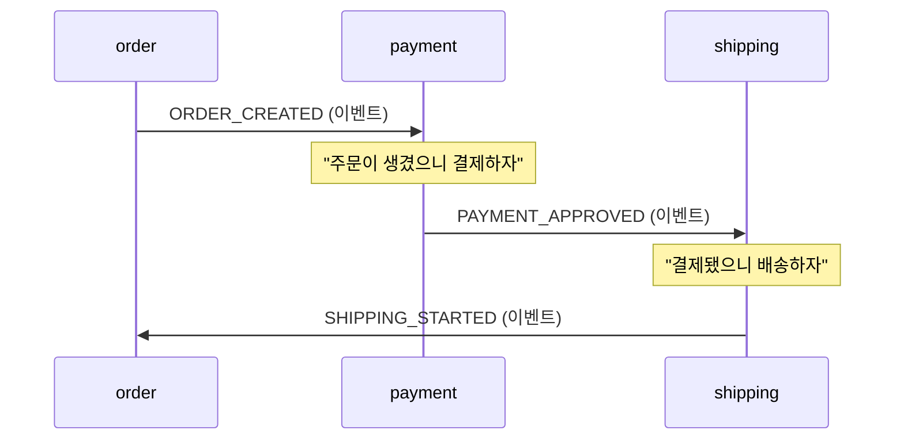

# 오케스트레이션과 코레오그래피

> 2026-10-15 결제창 방식 전환을 설계하다가, 결제 준비 메시지를 커맨드로 보낼지 이벤트로 보낼지 정하면서 정리했다.

둘 다 여러 서비스에 걸친 작업(사가)을 진행시키는 방식이다. 차이는 **다음에 무엇을 할지 누가 아느냐** 하나다.

- **오케스트레이션**: 조율자 한 명이 전체 순서를 알고 각 서비스에 지시한다. 서비스는 시킨 일만 하고 결과를 회신한다.
- **코레오그래피**: 조율자가 없다. 각 서비스가 다른 서비스의 이벤트를 보고 자기 차례인지 스스로 판단한다.

## 같은 흐름을 두 방식으로

주문 → 결제 → 배송 흐름이다. 배송은 설명을 위한 가상의 서비스다.

### 오케스트레이션

order가 "결제가 끝나면 배송"이라는 순서를 안다. payment와 shipping은 서로의 존재를 모른다.

### 코레오그래피

전체 순서를 아는 서비스가 없다. 흐름은 누가 어떤 이벤트를 구독하는지 모아 봐야 보인다. 화살표도 실제로는 특정 서비스로 보내는 게 아니라 토픽에 발행하는 것이다.

## 실패했을 때

배송이 실패한 경우다.

| | 오케스트레이션 | 코레오그래피 |
|---|---|---|
| 누가 알아채나 | 조율자가 실패 회신을 받음 | `SHIPPING_FAILED`를 구독한 서비스들 |
| 보상 진행 | 조율자가 "결제 취소해", "재고 풀어"를 차례로 지시 | 각 서비스가 스스로 자기 작업을 되돌림 |
| 보상 순서 | 조율자가 정함 | 정해져 있지 않음 |
| 멈춘 사가 찾기 | 사가 상태 테이블에서 오래 머문 행을 조회 | 중앙 상태가 없어 서비스마다 상태와 로그를 맞춰 봐야 함 |

**보상의 내용**(재고 반환, 결제 취소)은 두 방식이 같다. 달라지는 건 **보상을 누가 결정하고 어떤 순서로 하느냐**다.

참여 서비스가 둘뿐이면 차이가 거의 보이지 않는다. 어느 방식이든 "결과를 받은 쪽이 보상한다"가 된다. 차이는 참여자가 셋 이상으로 늘 때 드러난다.

## 장단점

| | 오케스트레이션 | 코레오그래피 |
|---|---|---|
| 흐름 파악 | 조율자 코드 한 곳만 읽으면 됨 | 여러 서비스의 구독 관계를 모아 봐야 함 |
| 결합도 | 조율자가 모든 참여자를 앎 | 서비스끼리 이벤트 형식으로만 느슨하게 연결 |
| 단계 추가 | 조율자를 고쳐야 함 | 새 서비스가 구독만 하면 됨 |
| 부담 | 조율자의 상태 관리와 장애 복구 | 흐름 추적, 순환 이벤트, 보상 누락 위험 |
| 잘 맞는 곳 | 순서와 보상이 중요한 흐름 (결제, 정산) | 실패해도 되돌릴 게 없는 반응 (알림, 검색 색인, 통계) |

실무에서는 섞어 쓴다. 돈이 오가는 핵심 흐름은 오케스트레이션으로 묶고, 그 결과를 주변 서비스에 이벤트로 흘려보낸다. Temporal, Camunda, AWS Step Functions는 조율자 역할을 맡아 주는 도구다.

## 커맨드·이벤트와의 관계

Kafka에서는 둘 다 그냥 메시지다. 차이는 의미에 있다.

| | 커맨드 | 이벤트 |
|---|---|---|
| 뜻 | "이것을 해라" | "이런 일이 있었다" |
| 이름 | 명령형 (`PREPARE_PAYMENT`) | 과거형 (`ORDER_COMPLETED`) |
| 받는 쪽 | 정해진 하나 | 0개 이상. 보내는 쪽은 누가 받는지 모름 |
| 거절 | 가능 | 불가. 이미 일어난 일이다 |
| 메시지 형식의 주인 | 받는 쪽 | 보내는 쪽 |

오케스트레이션은 커맨드와 회신으로, 코레오그래피는 이벤트로 움직인다. 커맨드는 거절할 수 있어서 **거절 회신이 보상의 출발점**이 된다. 이벤트에는 거절이 없으므로, 코레오그래피에서는 실패를 별도 이벤트(`PAYMENT_FAILED`)로 발행해야 다른 서비스가 보상을 시작한다.

정리하면 커맨드냐 이벤트냐는 메시지의 의미와 형식의 주인을 정하고, 보상을 누가 어떤 순서로 하느냐는 사가 방식이 정한다.

## 이 프로젝트에서는

| 토픽 | 메시지 성격 | 방식 |
|---|---|---|
| `payment.commands` | 커맨드 (order → payment) | 오케스트레이션 |
| `order.saga.replies` | 회신 (payment → order) | 오케스트레이션 |
| `order.events` | 이벤트 (`ORDER_COMPLETED`, `ORDER_CANCELED`) | 코레오그래피. 구독자는 order가 모름 |

- order가 조율자다. `saga_instance` 테이블이 진행 상태이고, `OrderSagaOrchestrator.decide()`가 회신을 보고 완료할지 보상할지 정한다.
- 결제 준비를 이벤트(`ORDER_CREATED`)가 아닌 커맨드(`PREPARE_PAYMENT`)로 보내기로 했다. 이벤트로 보내면 "주문이 생기면 결제를 준비한다"는 규칙이 payment 안에 숨고, payment가 order의 이벤트 형식에 맞춰야 한다. 돈을 다루는 쪽이 자기 입력 형식을 정하는 게 맞다.
- 멈춘 사가는 `StuckSagaDetector`가 사가 상태 테이블에서 찾는다. 중앙 상태가 있는 오케스트레이션이라 가능한 방식이다.

관련 문서: [Saga 패턴](../03-saga-pattern.md), [결제창 방식 전환 설계](../04-checkout-payment-design.md)
